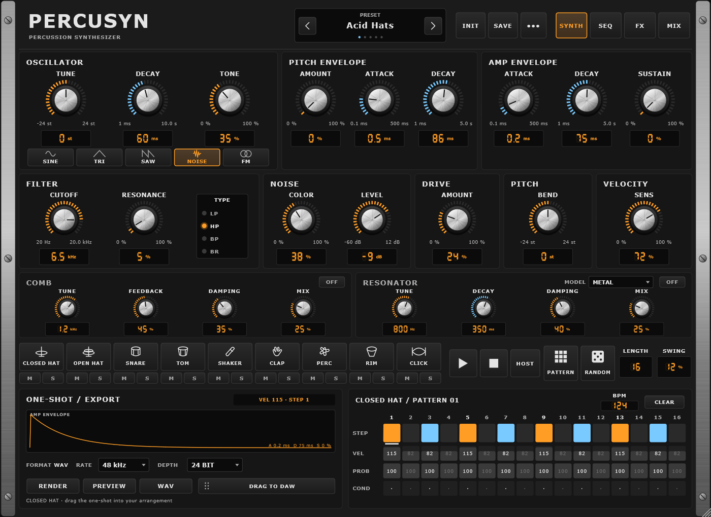
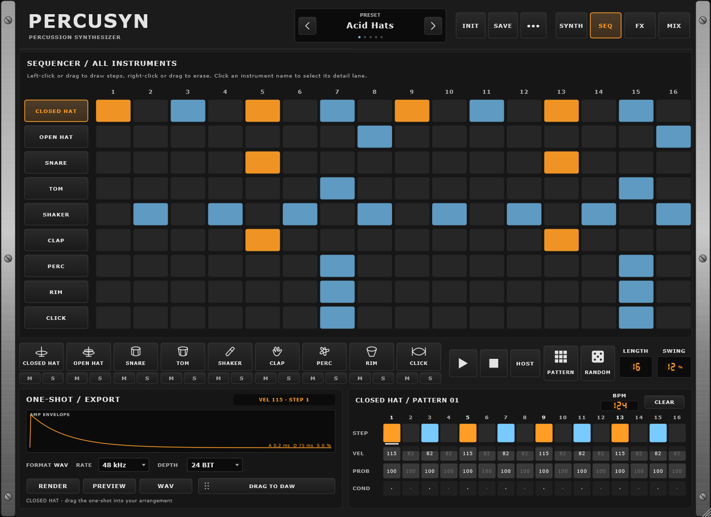
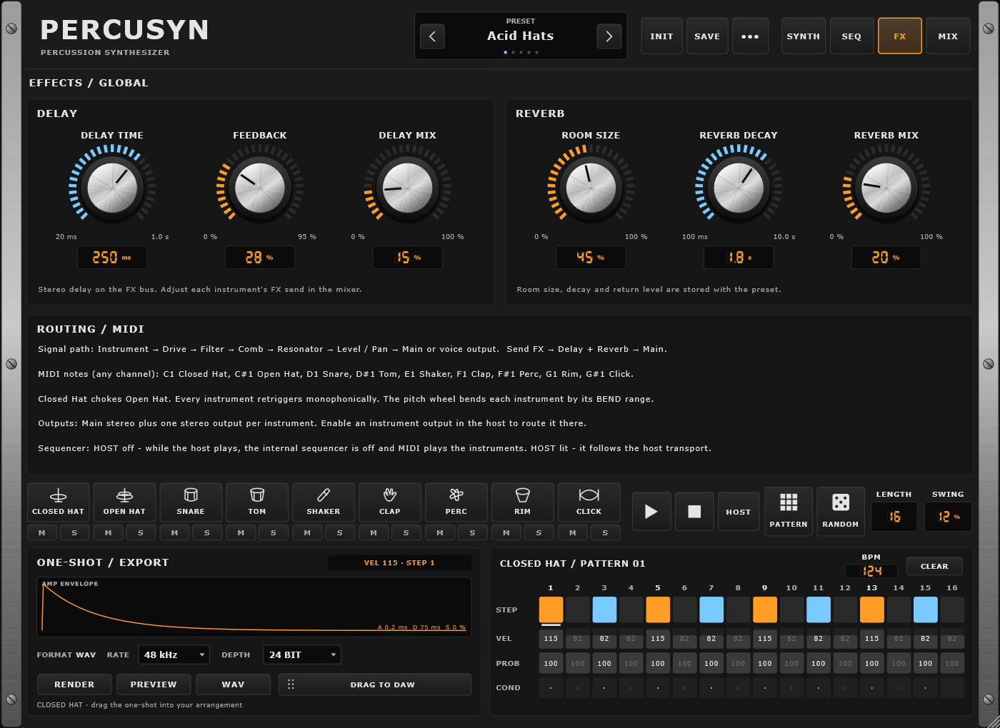
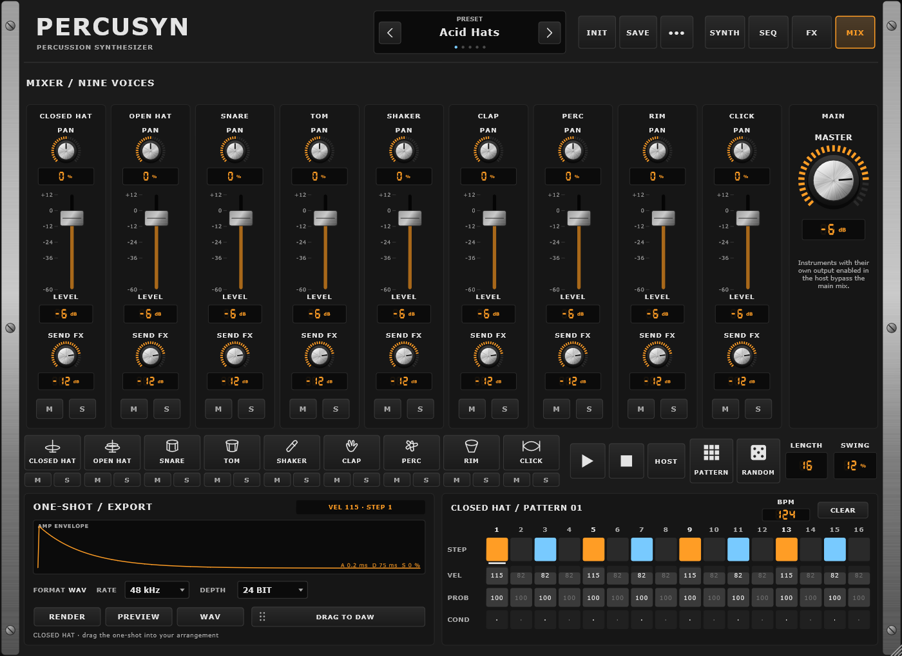

# PERCUSYN – Handbuch

PERCUSYN ist ein Percussion-Synthesizer mit neun Stimmen: **Closed Hat, Open Hat, Snare, Tom, Shaker, Clap, Perc, Rim und Click**. Jede Stimme wird synthetisch erzeugt (keine Samples) und hat eigenen Oszillator, eigene Hüllkurven, Noise, Drive, Filter, Comb und Resonator. Dazu kommen ein 16-Step-Sequencer, zwei Send-Effekte, ein Mixer mit Einzelausgängen und ein One-Shot-Renderer, der Samples direkt in die DAW ziehen lässt.

Die Oberfläche des Plugins ist englisch; die Bedienelemente heißen hier so wie auf dem Panel.



## Inhalt

1. [Installation](#installation)
2. [Schnellstart](#schnellstart)
3. [Das Panel](#das-panel)
4. [SYNTH-Seite](#synth-seite)
5. [Sequencer](#sequencer)
6. [FX-Seite](#fx-seite)
7. [MIX-Seite und Ausgänge](#mix-seite-und-ausgänge)
8. [MIDI](#midi)
9. [One-Shot-Export](#one-shot-export)
10. [Presets](#presets)
11. [Tipps und Fehlersuche](#tipps-und-fehlersuche)

## Installation

Das Paket für dein System von der Seite [Releases](https://github.com/sscheppert-blip/PERCUSYN/releases) laden und entpacken.

| System | Format | Ordner |
| --- | --- | --- |
| Windows | VST3 | `C:\Program Files\Common Files\VST3` |
| Windows | CLAP | `C:\Program Files\Common Files\CLAP` |
| macOS (Apple Silicon) | AU | `~/Library/Audio/Plug-Ins/Components` |
| macOS | VST3 | `~/Library/Audio/Plug-Ins/VST3` |
| macOS | CLAP | `~/Library/Audio/Plug-Ins/CLAP` |
| Linux | VST3 | `~/.vst3` |
| Linux | CLAP | `~/.clap` |

Die **Standalone**-App läuft ohne DAW (Audio- und MIDI-Gerät unter *Options* wählen).

Die Plugins sind nicht signiert. Unter Windows kann SmartScreen bei der Standalone-App warnen. Unter macOS nach dem Kopieren einmal die Download-Quarantäne entfernen, zum Beispiel:

```bash
xattr -dr com.apple.quarantine ~/Library/Audio/Plug-Ins/Components/PERCUSYN.component
```

Danach die Plugins in der DAW neu scannen. PERCUSYN erscheint als Instrument von *sscheppert-blip*.

## Schnellstart

1. PERCUSYN auf eine Instrumentenspur laden. Geladen ist das erste Factory-Kit, **Acid Hats**.
2. In der Instrumentenleiste **▶** drücken: Der interne Sequencer spielt (solange die DAW steht).
3. Eine Instrumenten-Taste anklicken, zum Beispiel **SNARE**: Sie wird zum Bearbeiten ausgewählt und einmal angespielt.
4. Auf der SYNTH-Seite an den Knöpfen drehen: nach oben/unten ziehen, mit **Shift** fein, Doppelklick setzt zurück.
5. In der Spur unten rechts Steps zeichnen: **linke** Maustaste gedrückt halten und ziehen zeichnet, **rechte** Maustaste gedrückt halten und ziehen löscht.
6. Die Stimmen per MIDI-Keyboard oder Clip spielen: **C1** (Note 36) ist die Closed Hat, dann aufwärts in der Reihenfolge der Tasten.

## Das Panel

Das Fenster lässt sich an der rechten unteren Ecke frei vergrößern und verkleinern; das ganze Instrument skaliert mit und behält seine Proportionen.

- **Kopfzeile:** Preset-Anzeige mit **‹ ›** (vorheriges/nächstes) – ein Klick auf den Namen öffnet die Preset-Liste –, **INIT** (alle Stimmen auf Standard, alle Steps gelöscht), **SAVE** (User-Preset) und **•••** (JSON exportieren/importieren, User-Preset löschen, Preset- oder Render-Ordner öffnen, Hilfe). **SYNTH / SEQ / FX / MIX** schalten die Hauptseite um.
- **Instrumentenleiste** (auf jeder Seite): Die neun Instrumenten-Tasten leuchten, wenn sie ausgewählt sind, und blitzen, wenn sie spielen. Ein Klick wählt die Stimme aus und spielt sie an. **M** und **S** darunter schalten die Stimme stumm bzw. solo. Dann folgen **▶ / ■** (interner Sequencer), **HOST** (Sequencer folgt der DAW, siehe [Sequencer](#sequencer)), **PATTERN** (öffnet die SEQ-Seite), **RANDOM** (zufällige Steps und Velocities für die gewählte Stimme), **LENGTH** (1–16 Steps) und **SWING**.
- **Unten links:** One-Shot-Export. **Unten rechts:** die Step-Spur der gewählten Stimme und das interne Tempo (**BPM**).

Jede Zahlenanzeige lässt sich anklicken, um einen genauen Wert einzutippen. Fährt man mit der Maus über ein Bedienelement, erscheint eine Erklärung.

**Farben der LED-Ringe:** Blaue Ringe zeigen Zeiten (ms/s), orange Ringe alles andere (Tonhöhe, Klangfarbe, Pegel, Mischung).

## SYNTH-Seite

Alle Regler dieser Seite gehören zur gewählten Stimme.

### Oszillator

| Regler | Funktion |
| --- | --- |
| TUNE | Tonhöhe in Halbtönen (±24). |
| DECAY | Wie schnell der tonale Oszillator-Anteil abklingt (1 ms – 10 s). Die Noise-Ebene ist davon unabhängig, sie folgt der Amp-Hüllkurve. Kurzes Osc Decay mit längerem Amp Decay ergibt einen Klick mit Rauschfahne. |
| TONE | Klangfarbe, je nach Wellenform: **SINE/TRI** Wavefolding (mehr Obertöne), **SAW** Helligkeit, **NOISE** Überblendung von weißem Rauschen zu einem metallischen Cluster aus sechs verstimmten Rechtecken (klassische Hi-Hat-Quelle), **FM** Modulationstiefe (mit einem unharmonischen Verhältnis pro Stimme; die Tiefe folgt dem Oszillator-Decay). |
| SINE / TRI / SAW / NOISE / FM | Wellenform des Oszillators. |

### Pitch-Hüllkurve

**AMOUNT** bestimmt, wie weit über TUNE der Schlag beginnt (bis vier Oktaven bei 100 %). **ATTACK** ist die Anstiegszeit, **DECAY** die Zeit zurück auf TUNE.

### Amp-Hüllkurve

**ATTACK** und **DECAY** formen den Pegel der ganzen Stimme. **SUSTAIN** ist der Pegel, der gehalten wird, solange eine MIDI-Note gedrückt ist (beim Sequencer einen Step lang); nach dem Notenende fällt der Pegel mit der DECAY-Zeit. Bei **0 %** (Standard) ist jeder Schlag ein reiner One-Shot und die Notenlänge spielt keine Rolle.

### Filter, Noise, Drive, Pitch, Velocity

| Regler | Funktion |
| --- | --- |
| CUTOFF / RESONANCE / TYPE | State-Variable-Filter: LP (Tiefpass), HP (Hochpass), BP (Bandpass), BR (Bandsperre). |
| NOISE COLOR | Rauschspektrum von dunkel (0 %) über weiß (50 %) bis hell (100 %). |
| NOISE LEVEL | Pegel der Noise-Ebene (-60 bis +12 dB). |
| DRIVE AMOUNT | Sättigung vor dem Filter. |
| PITCH BEND | Wie weit das MIDI-Pitch-Wheel diese Stimme verstimmt (±24 Halbtöne; negativ dreht die Richtung um, 0 ignoriert das Wheel). |
| VELOCITY SENS | 0 % = jeder Schlag mit vollem Pegel; 100 % = Pegel folgt der Velocity ganz. |

### Comb und Resonator

Jede Stimme hat hinter dem Filter zwei metallische Stufen mit eigenem **ON/OFF**. Die Einstellungen bleiben erhalten, wenn eine Stufe aus ist; die Ringe der Knöpfe sind dann gedimmt.

- **COMB** – ein gestimmter Feedback-Kammfilter für hohles, tonales oder metallisches Klingeln. **TUNE** (20 Hz – 12 kHz) stimmt das Klingeln, **FEEDBACK** (bis 95 %) bestimmt seine Länge, **DAMPING** macht es dunkler, **MIX** mischt es zum trockenen Klang.
- **RESONATOR** – sechs Resonanzmoden, die von der Stimme angeregt werden. **MODEL**: **METAL** (freier Metallstab, stark unharmonisch), **PLATE** (runde Platte) oder **TUBE** (geschlossenes Rohr, ungerade Obertöne). **TUNE** stimmt die tiefste Mode, **DECAY** bestimmt, wie lange sie klingt (Zeit bis -60 dB), **DAMPING** verkürzt die höheren Moden, **MIX** mischt.

Signalweg einer Stimme: Oszillator + Noise → Drive → Filter → Comb → Resonator → Level/Pan → Hauptausgang oder eigener Ausgang der Stimme; der FX-Send speist Delay und Reverb.

## Sequencer



Jede Stimme hat 16 Steps. Die **SEQ**-Seite zeigt alle neun Spuren, die Spur unten rechts die Details der gewählten Stimme.

- **Zeichnen und löschen:** **linke** Maustaste gedrückt halten und über Steps ziehen schaltet sie ein, **rechte** Maustaste gedrückt halten und ziehen schaltet sie aus – in einem Zug, auf der SEQ-Seite auch über mehrere Stimmen. Der Step, den du links anklickst, ist auch der Step für den One-Shot-Render (darunter mit einem Strich markiert).
- **VEL** (1–127): nach oben/unten ziehen oder Mausrad; Doppelklick zum Eintippen.
- **PROB** (0–100 %): Wahrscheinlichkeit, dass der Step spielt.
- **COND**: Klick schaltet weiter: **·** (jeder Durchlauf), **1:2** (erster von je zwei Durchläufen), **2:2** (zweiter von zwei), **1:4** (erster von vier). Mit Shift rückwärts.
- **CLEAR** schaltet alle Steps der gewählten Spur aus (Velocity, Wahrscheinlichkeit und Bedingung bleiben).
- **LENGTH** setzt die Pattern-Länge (Steps dahinter bleiben erhalten, spielen aber nicht), **SWING** verzögert jedes zweite Sechzehntel.

### Interner Sequencer und DAW

- **DAW steht:** **▶** startet den internen Sequencer mit dem **BPM**-Wert aus der Spur, **■** stoppt und springt auf Step 1.
- **DAW spielt, HOST aus (Standard):** Der interne Sequencer ist aus. PERCUSYN wird mit MIDI-Noten aus der DAW gespielt.
- **DAW spielt, HOST leuchtet:** Der Sequencer folgt Transport und Tempo der DAW, taktgenau (auch bei Loops und Sprüngen).

MIDI-Noten spielen die Stimmen in jedem Modus; Pattern und Noten aus einem Clip lassen sich also kombinieren.

## FX-Seite



Zwei globale Effekte am FX-Bus. Jede Stimme speist sie über ihren **SEND FX** (MIX-Seite).

- **DELAY:** Stereo-Delay mit **DELAY TIME** (20 ms – 1 s), **FEEDBACK** und **DELAY MIX** (Rückführpegel).
- **REVERB:** **ROOM SIZE**, **REVERB DECAY** (100 ms – 10 s) und **REVERB MIX** (Rückführpegel).

Die Seite fasst außerdem Signalweg, MIDI-Noten und Ausgänge zusammen.

## MIX-Seite und Ausgänge



Pro Stimme: **PAN**, **LEVEL**-Fader (-60 bis +12 dB), **SEND FX** und **M**/**S** (Mute/Solo; mehrere Stimmen gleichzeitig solo möglich). **MASTER** regelt den Pegel des Hauptausgangs.

**Ausgänge:** PERCUSYN hat einen Stereo-Hauptausgang und pro Stimme einen eigenen Stereo-Ausgang („Closed Hat", „Open Hat", …). Wird ein Stimmen-Ausgang in der DAW aktiviert, verlässt diese Stimme den Hauptmix und spielt nur noch dort (ihr FX-Send geht weiter in die Effekte des Hauptausgangs). Master wirkt nicht auf die Einzelausgänge.

## MIDI

| Note | Stimme |
| --- | --- |
| C1 (36) | Closed Hat |
| C#1 (37) | Open Hat |
| D1 (38) | Snare |
| D#1 (39) | Tom |
| E1 (40) | Shaker |
| F1 (41) | Clap |
| F#1 (42) | Perc |
| G1 (43) | Rim |
| G#1 (44) | Click |

Alle MIDI-Kanäle werden angenommen. Die Velocity wirkt je nach VELOCITY SENS. **Die Closed Hat würgt die Open Hat ab.** Jede Stimme ist monophon: Ein neuer Schlag blendet den vorigen derselben Stimme schnell aus, Comb und Resonator klingen dabei natürlich weiter. Das Pitch-Wheel verstimmt jede Stimme um ihren PITCH-BEND-Bereich. Manche DAWs nennen Note 36 „C2"; es ist dieselbe Taste.

## One-Shot-Export

Das Feld unten links macht aus der gewählten Stimme ein WAV-Sample.

1. Stimme wählen und den Step links anklicken, dessen **Velocity** verwendet werden soll (das Schild zeigt **VEL** und **STEP**).
2. **RATE** (44,1/48/96 kHz) und **DEPTH** (16 oder 24 Bit PCM, 32 Bit Float) wählen.
3. **RENDER** berechnet den One-Shot und zeigt seine Wellenform. **PREVIEW** spielt ihn auf dem Hauptausgang ab. **WAV** speichert eine Kopie an einem beliebigen Ort.
4. **DRAG TO DAW:** Dieses Feld ins Arrangement oder in einen Sampler ziehen – die WAV-Datei wird (falls nötig) erzeugt und dort abgelegt.

Gerendert wird die gewählte Stimme samt Comb, Resonator, Level und Pan, in Stereo, bis der Ausklang unter -90 dBFS fällt (höchstens 10 s). Globale Effekte und Master sind nicht enthalten, normalisiert wird nichts. Die laufende Wiedergabe bleibt unberührt. Gerenderte Dateien bleiben in **Dokumente/PERCUSYN/Renders**, damit abgelegte Dateien auch nach dem Schließen des Plugins funktionieren.

## Presets

Ein Preset enthält **alles**: alle neun Stimmen, Comb- und Resonator-Einstellungen, die Patterns, Länge, Swing, Tempo, FX und Mixer.

- Sechs Factory-Kits: Acid Hats, Warehouse 909, Dust & Metal, Broken Circuit, Minimal Pulse und Metal Controls Demo.
- **SAVE** speichert ein User-Preset (eine JSON-Datei im Anwendungsdaten-Ordner des Benutzers, `PERCUSYN/Presets`; *••• → Show preset folder* öffnet ihn).
- **••• → Export / Import preset JSON** tauscht Presets als Dateien aus. Importierte Presets werden erst mit SAVE zu User-Presets.
- Das DAW-Projekt speichert den kompletten Zustand jeder Instanz ohnehin mit.

## Tipps und Fehlersuche

- **Metallische Hats:** Wellenform NOISE, TONE hoch, HP-Filter, kurze Decays; dazu den Resonator (METAL, Tune 3–6 kHz) mit etwas Mix.
- **Toms und Percussion:** SINE mit Pitch-Hüllkurve; der Comb, auf die Tonhöhe der Tom gestimmt, gibt einen hohlen Körper.
- **Claps** bekommen ihre drei schnellen Anschläge automatisch; ein längeres AMP DECAY macht den Raum größer.
- **Kein Ton, während die DAW spielt:** Bei HOST aus stoppt der interne Sequencer, solange die DAW spielt – MIDI-Noten schicken oder HOST einschalten.
- **Eine Stimme ist stumm:** ihre **M**/**S**-Tasten prüfen und ob ihr Einzelausgang in der DAW aktiviert ist.
- **Das Plugin erscheint nicht:** Ordner aus der Installationstabelle prüfen und neu scannen; unter macOS die Quarantäne wie oben entfernen.
